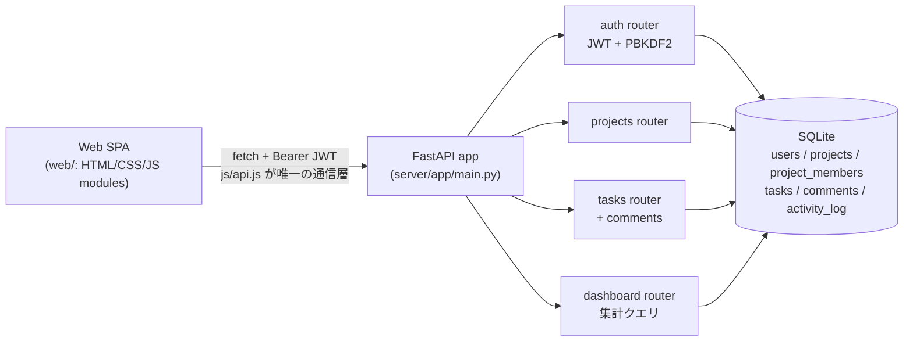

# FlowDesk アーキテクチャ

## 構成

## 設計判断

- **通信層の一本化**: フロントエンドは `web/js/api.js` 経由でのみ API を叩く。fetch・認証ヘッダ・エラー形式の知識を1か所に閉じ込め、画面側はドメイン操作だけを書く。
- **権限は「見せない」方式**: プロジェクトの非メンバーには 403 ではなく 404 を返す。存在自体を漏らさない。書き込み権限はロール（owner / member / viewer）で判定し、viewer は読み取り専用。
- **活動ログ**: タスク作成・ステータス変更・コメント等を `activity_log` に記録し、ダッシュボードのフィードと監査の両方に使う。
- **DB は SQLite、ただし境界を明確に**: 接続とスキーマは `app/database.py` に集約。全クエリをパラメータ化し、将来 PostgreSQL 等へ移す場合もこの層の差し替えで済む構成にした。
- **認証**: パスワードは PBKDF2-HMAC-SHA256（ソルト付き）で保存し、平文・可逆暗号は使わない。トークンは有効期限24時間の JWT。

## スケールへの道筋（今後の拡張）

1. DB を PostgreSQL に移し、接続プールとマイグレーション（Alembic）を導入
2. リアルタイム更新（WebSocket）でボードの同時編集に対応
3. 通知（メール／Webhook）と監査ログのエクスポート
4. API のバージョニング（/api/v1）とレート制限
